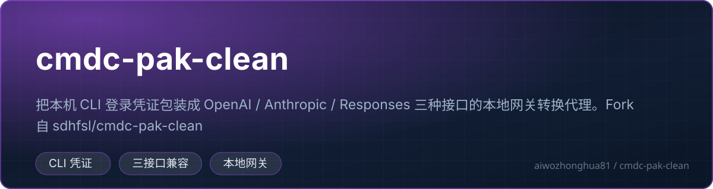

<!-- 中文说明开始 -->

# 🇨🇳 cmdc-pak-clean 中文详细说明

<!-- 徽章区开始 -->
<p align="center">
  <a href="https://github.com/aiwozhonghua81/cmdc-pak-clean"></a>
  
  
  
  
  
</p>
<p align="center">
  
  
  
</p>
<p align="center">
  
</p>
<!-- 徽章区结束 -->

> 这一节是为中文读者写的完整说明，放在最前面。
> 往下滚可以看到**上游项目的原始 README**，内容一个字都没有删改。

---

## 🧐 一、这是什么

**一句话：一个跑在自己电脑上的「翻译官」，把本机的 Command Code 登录状态包装成三种主流 AI 接口格式，让任何支持 OpenAI / Anthropic 协议的编辑器或工具都能直接连上。**

把它拆开看就三层：

```text
你的 AI 工具（Cursor / Claude Code / Codex …）
        │  发标准 OpenAI 或 Anthropic 格式请求
        ▼
   cmdc-pak-clean（本地小代理，127.0.0.1:8787）
        │  翻译格式 + 补上凭证 + 加工具调用
        ▼
  Command Code 官方网关（api.commandcode.ai）
```

| 概念 | 大白话解释 |
| --- | --- |
| **Command Code** | 一个提供大模型 API 服务的商业服务（官网 commandcode.ai）。它有自己的账号体系和 API Key，模型包括 deepseek、glm、grok、MiniMax 等。 |
| **协议 / 格式** | 不同 AI 工具之间约定俗成的「说话方式」。OpenAI 有 OpenAI 的格式，Anthropic（Claude）有 Anthropic 的格式，Codex 又用 Responses 格式。就像 HDMI 和 DisplayPort 都能传画面，但接口形状不一样。 |
| **网关 / 代理** | 一个中间人。客户端说 A 语言，它翻译成 B 语言发给上游，再把回答翻译回来。 |
| **凭证（auth.json）** | 你在 Command Code 桌面版登录后，它在本机存下的登录状态文件，里面有 API Key。本工具读取这个文件，**不需要你手抄 Key**。 |
| **思考链（thinking / reasoning）** | 现在很多推理模型会先「想一想」再回答，那段内部推理过程可以以流式片段返回给客户端。本工具把它原样透传，客户端界面就能实时显示模型的思考过程。 |

**为什么需要它？**

因为 Command Code 官方提供的是它自己那套接口格式，而你常用的工具（Cursor、Claude Code、Codex 等）只认 OpenAI / Anthropic 格式。没有中间层的话，你要么改客户端源码，要么放弃其中一边。

**它的三条设计原则（这也是本项目和一堆同类项目最不一样的地方）：**

1. **不内置任何校验逻辑** —— 不做套餐/余额/权限校验，只做「格式翻译 + 转发」。
2. **不含任何硬编码凭证** —— 所有凭证都来自你本机的登录状态，程序里一个 Key 都没有，代码审计时一眼能看清。
3. **只绑定 127.0.0.1** —— 只监听本机回环地址，局域网里的其他机器访问不到。

---

## 👥 二、适合谁用 / 能解决什么问题

### 典型使用场景

| 场景 | 怎么用 |
| --- | --- |
| **在 Cursor / Z Code 里用 Command Code 的额度** | 把 Cursor 的 Base URL 改成 `http://localhost:8787/v1`，API Key 随便填一个（本地代理不校验），就能直接调用。 |
| **让 Claude Code / Claude 系客户端接上 Command Code** | Base URL 同样填 `http://localhost:8787/v1`，协议选 Anthropic Messages。 |
| **让 Codex 接上 Command Code** | Base URL 填 `http://localhost:8787/v1`，协议选 Responses。 |
| **想在多个工具之间共用一份账号** | 只登录一次 Command Code 桌面版，所有工具都从本机这个代理走。 |
| **想要一个可视化小面板看看状态** | 启动后浏览器打开 `http://127.0.0.1:8787/`，能看到余额、窗口用量、请求日志、模型搜索，还能一键重启服务。 |

### 它**不**适合谁

- **想在 Linux 服务器 / Docker 里跑的人**：它读的是 Windows 桌面版 Command Code 的本地登录文件（`~/.commandcode/auth.json`），路径探测逻辑也是围绕 Windows 写的（`%APPDATA%`、`%LOCALAPPDATA%`、`rundll32`）。
- **想要多账号轮询 / 故障转移的人**：那应该用 `cmdcode2api`（见末尾的相关仓库一节）。
- **想要完整 WebUI 管理台的人**：`cmdc-pak-clean` 的面板很轻量（单页 HTML），要完整账号管理界面请用 `cmdcode2api`。

---

## ⚙️ 三、核心功能

| # | 功能 | 大白话说明 |
| --- | --- | --- |
| 1 | **三协议入口** | 同时提供 `/v1/chat/completions`（OpenAI 格式）、`/v1/messages`（Anthropic 格式）、`/v1/responses`（OpenAI Responses / Codex 格式）。一个端口，三种语言。 |
| 2 | **思考链透传** | Anthropic 通道强制把思考强度拉到最大档，`thinking_delta` 逐块 1:1 转发；OpenAI Chat 通道则用 `reasoning_content` 字段返回。**不吞、不改写、不丢字段。** |
| 3 | **工具调用（tool call）全链路转换** | `tool_calls` / `tool-call` 在三种协议之间来回转换，工具名大小写做映射，畸形参数（`null`、被数组包了一层、直接是个字符串）都归一化成标准形状。 |
| 4 | **模型目录自动解析** | 直接从本机 Command Code 桌面版的 harness 文件里读出：有哪些模型、每个模型上下文窗口多大、有哪几档思考强度。读不到就用内置的兜底列表。 |
| 5 | **上下文预算动态收窄** | 上游硬性要求「输入 + 输出 ≤ 上下文窗口」。对话聊长了，固定输出预算就塞不下了。本工具会估算当前输入占用了多少，再把输出预算缩到剩下的空间，让长对话优雅降级而不是直接报错。 |
| 6 | **Web 面板** | `/api/status`、`/api/config` 两个接口，配合内置单页 HTML 面板，实时显示余额、窗口用量、请求日志、模型搜索。 |
| 7 | **上游 TLS 闪断自动重试** | 遇到瞬时的 TLS 握手 / 传输层故障，自动换一条新连接重试一次（日志里会记 `upstream TLS/transport blip`）。 |
| 8 | **单实例检测 + 端口自动顺延** | 重复双击不会启动两个实例（而是把已有面板重新打开）；端口被别的程序占了会自动往后顺延找可用端口。 |
| 9 | **上游空闲超时保护** | 默认 180 秒收不到任何字节就主动断开，避免连接挂着白占资源。 |
| 10 | **原子配置写入** | 配置文件先写临时文件再原子替换，程序崩溃写到一半也不会把配置写坏。 |

---

## 🚀 四、怎么快速上手

### 4.1 前置条件

1. **Windows 系统**（工具链和路径探测都围绕 Windows 设计）。
2. **已安装 Command Code 桌面版并登录成功** —— 登录后本机会有 `~/.commandcode/auth.json`。
   > 你可以打开这个文件确认一下：里面应该有 `apiKey`、`userId`、`userName` 等字段。
3. **Go 1.21+**（`go.mod` 里写的是 `go 1.21`）。

### 4.2 构建

在仓库根目录执行：

```bash
go build -ldflags="-s -w -H=windowsgui" -o cmdc-pak-clean.exe .
```

**这条命令逐段解释：**

| 片段 | 作用 |
| --- | --- |
| `go build` | 编译 Go 程序 |
| `-ldflags="-s -w"` | 去掉调试符号表和 DWARF 信息，**二进制体积明显变小** |
| `-H=windowsgui` | 链接成 **Windows GUI 程序**——双击运行时**不弹出黑色控制台窗口**，像普通软件一样。日志改写到文件里。 |
| `-o cmdc-pak-clean.exe` | 输出文件名 |
| `.` | 表示编译当前目录这个包 |

> **为什么加了 `-H=windowsgui` 还要写日志到文件？**
> 因为没有控制台窗口了，`stdout`/`stderr` 就无处可去。所以程序把所有日志写进配置文件目录下的 `cmdc-pak-clean.log`。想看日志就去那个文件里翻。

**如果你想要一个带控制台窗口的版本**（方便调试），去掉 `-H=windowsgui` 即可：

```bash
go build -o cmdc-pak-clean.exe .
```

### 4.3 运行

```bash
./cmdc-pak-clean.exe
```

启动后会自动用系统默认浏览器打开面板：`http://127.0.0.1:8787/`。

**如果端口被占了**：程序会自动往后顺延（8788、8789……），实际端口看启动日志或者面板上的显示。

**如果想让它安静地跑（不弹浏览器）**：

```bash
set CMDC_PAK_NO_BROWSER=1
./cmdc-pak-clean.exe
```

### 4.4 让你的 AI 工具连上来

启动后，在你的客户端里按下面这张表填：

| 客户端 | Base URL | API Key | 协议 |
| --- | --- | --- | --- |
| **Z Code / Cursor** | `http://localhost:8787/v1` | 任意（比如 `local-proxy`） | Chat Completions |
| **Claude 系客户端** | `http://localhost:8787/v1` | 任意 | Anthropic Messages |
| **Codex** | `http://localhost:8787/v1` | 任意 | Responses |

> **为什么 API Key 可以随便填？**
> 因为这个工具跑在你自己的电脑上，只监听 127.0.0.1，物理上局域网和公网的机器都访问不到它，所以没必要再套一层 Key 校验。填 `local-proxy` 之类的字符串只是为了满足客户端「必须有 key」的表单要求。

### 4.5 跑测试

```bash
# 全部测试
go test ./...

# 带详细输出
go test -v ./...
```

仓库里的测试文件覆盖了这些场景：

| 测试文件 | 测什么 |
| --- | --- |
| `context_budget_test.go` | 上下文预算收窄逻辑 |
| `pairing_test.go` | 工具调用与结果的配对 |
| `alias_fix_test.go` | 模型别名 / 后缀改写 |
| `fallback_test.go` / `fallback_verify_test.go` | 兜底模型目录 |
| `cliver_fallback_test.go` | CLI 版本兜底 |
| `retry_test.go` | 上游重试 |
| `idle_test.go` | 空闲超时 |
| `decision_test.go` | 决策分支 |
| `hostile_test.go` | 恶意 / 畸形输入 |
| `fuzz_test.go` / `fuzz_lanes_test.go` | 模糊测试（随机数据轰炸不崩） |

---

## 🎛️ 五、环境变量

全部通过环境变量配置，程序启动时读取。

| 变量 | 默认值 | 说明 |
| --- | --- | --- |
| `CMDC_PAK_PORT` | `8787` | 监听端口。被占用时自动顺延。 |
| `CMDC_PAK_CONFIG_DIR` | `%APPDATA%\cmdc-pak-clean` | 配置和日志存放目录。非 Windows 上回退到 `~/.cmdc-pak-clean`。 |
| `CMDC_PAK_AUTH_FILE` | `~/.commandcode/auth.json` | 凭证文件路径覆盖。程序会依次尝试：`$CMDC_PAK_AUTH_FILE` → `~/.commandcode/auth.json` → `~/.commandcode/auth.local.json` → `%USERPROFILE%\.commandcode\auth.json`。 |
| `CMDC_PAK_GATEWAY_URL` | 官方网关（`https://api.commandcode.ai`） | 上游地址覆盖。 |
| `CMDC_PAK_IDLE_TIMEOUT` | `180` | 上游流空闲超时（秒）。 |
| `CMDC_PAK_FORCE_EFFORT` | 开 | 设为 `off` 可以关掉「思考档位拉满」的行为。 |
| `CMDC_PAK_TOOL_NUDGE` | 关 | 设为 `1` 时，在 system 提示词末尾追加一句「优先使用工具」。**只在请求声明了 tools 时才追加。** |
| `CMDC_HARNESS_PATH` | 自动探测 | 桌面版 harness 文件路径覆盖。 |
| `CMDC_PAK_NO_BROWSER` | 关 | 设为 `1` 启动时不自动打开面板。 |
| `CMDC_PAK_TOKEN` | — | 备用凭证。当本机没有 `auth.json` 时，用这个当 API Key。 |
| `CMDC_PAK_PROJECT_DIR` | 当前工作目录 | 项目目录（会作为上下文发给上游）。 |
| `CMDC_PAK_RESTART_NONCE` | — | 内部使用：面板点「重启」时派生的子进程靠它识别自己，避免被单实例检测误杀。 |

---

## 🔌 六、HTTP 接口一览

所有接口都只监听 `127.0.0.1`。

| 方法 | 路径 | 作用 |
| --- | --- | --- |
| `GET` | `/` | Web 面板（单页 HTML） |
| `GET` | `/api/status` | 面板状态：端口、运行时长、凭证（打码）、日志、模型目录、余额/用量 |
| `POST` | `/api/config` | 改配置（改端口、重启进程等）。**有 CSRF 防护**，见下方说明。 |
| `POST` | `/api/restart` | 重启服务 |
| `POST` | `/v1/chat/completions` | OpenAI Chat Completions 协议 |
| `POST` | `/v1/messages` | Anthropic Messages 协议 |
| `POST` | `/messages` | 同上（不带 `/v1` 前缀的别名） |
| `POST` | `/v1/responses` | OpenAI Responses 协议 |
| `POST` | `/responses` | 同上（别名） |
| `GET` | `/v1/models` | 模型列表 |
| `GET` | `/health` | 健康检查，返回 `{"ok":true}` |
| `GET` | `/v1/chat` | 明确返回 404（防止有人误用这个不存在的路径） |

> **为什么会有 `/v1/chat` 专门返回 404？**
> 因为有些客户端（和某些拼错的人）会请求 `/v1/chat`。与其让它返回一个含糊的错误，不如明确告诉它「这个接口不存在」，省得排查半天。

---

## 🩺 七、常见问题 / 注意事项

### 7.1 启动相关

| 现象 | 原因和解决办法 |
| --- | --- |
| **双击后什么也没发生** | 你是用 `-H=windowsgui` 编译的 GUI 版本，没有控制台窗口。**去看日志文件**：`<配置目录>\cmdc-pak-clean.log`。也可以看看浏览器是不是自动打开了面板。 |
| **提示「already running」** | 已经在跑了。程序检测到端口上有自己的实例，就不会启动第二个，而是**把已有面板重新打开**。这是正常行为，不是错误。 |
| **端口被占用** | 如果占用者是别的程序，日志会显示 `port N occupied by another program, trying next ports`，程序自动顺延。 |
| **找不到 Go 命令** | 装 Go 并把它加进 PATH。`go version` 能跑通就行。 |

### 7.2 凭证相关（最常见的坑）

| 现象 | 原因和解决办法 |
| --- | --- |
| **日志显示 `no local auth found`** | 找不到 `~/.commandcode/auth.json`。先确认 Command Code 桌面版装好并登录过；也可以用 `CMDC_PAK_AUTH_FILE` 手动指定路径。 |
| **改了 auth.json 但没生效** | 凭证有 30 秒缓存（`authCacheTTL`），稍等一下或者重启程序。 |
| **API Key 突然 403** | 上游的 Key 可能过期或被撤销了。重新在 Command Code 桌面版登录一次，让它刷新 `auth.json`。 |
| **想知道 Key 有没有被读对** | 面板的 `/api/status` 里，凭证是**打码显示**的（比如 `sk-…abcd`），不会明文暴露。 |
| **能用备用 Token 吗** | 可以。设置 `CMDC_PAK_TOKEN` 环境变量，本机没有 auth.json 时用它。 |

### 7.3 模型相关

| 现象 | 原因和解决办法 |
| --- | --- |
| **`/v1/models` 返回的模型不对** | 模型目录来自本机桌面版的 harness 文件。桌面版升级后目录会变；用 `CMDC_HARNESS_PATH` 手动指定可以强制指向某个版本。 |
| **读不到 harness** | 程序有内置兜底列表（`fallbackSpecs`），包含 deepseek-v4-flash、glm-5.3-flash、grok-4.5、MiniMax-M3 等已知模型及各自的上下文窗口和思考档位。 |
| **上下文预算被收窄了** | 这是**设计如此**，不是 bug。长对话输入本身就快占满窗口了，再按固定额度输出就会超限。程序估算输入 token（按中英文/代码/base64 不同的字符权重算），再留出 6144 token 的安全余量，把输出预算缩到剩下的空间。 |
| **输出预算被压到很小** | 下限是 1024 token。就算历史已经几乎填满窗口，也会留 1024 给你把这一轮说完。 |
| **模型名写短了会报错** | 模型 ID 要**完整**，包括厂商前缀。比如 `deepseek/deepseek-v4-flash` 是对的，`deepseek-v4-flash` 和 `deepseek-ai/deepseek-v4-flash` 都不行。 |

### 7.4 工具调用相关

| 现象 | 说明 |
| --- | --- |
| **工具调用对不上** | 工具调用必须有「调用 + 返回结果」成对出现。历史消息里如果只有调用没有结果，上游会拒。本项目专门做了配对修复（commit `fix: 补全工具调用历史配对`），覆盖 Anthropic 通道。 |
| **工具参数格式怪异也能用** | 程序会归一化：`null`、被数组包一层、直接给字符串，都会转成上游能吃的形状。 |
| **模型不用工具** | 可以设 `CMDC_PAK_TOOL_NUDGE=1`，在 system 提示词末尾加一句引导。 |

### 7.5 安全相关

| 事项 | 说明 |
| --- | --- |
| **只监听本机** | 服务绑定 `127.0.0.1`，外部机器访问不到。这是这个工具最大的安全前提。 |
| **`/api/config` 有 CSRF 防护** | 两个检查：① 请求的 `Host` 必须是 `localhost` / `127.0.0.1` / `::1`；② 如果请求带了 `Origin` 头，它也必须是回环地址。浏览器发跨站请求会带 Origin，非浏览器客户端（curl、SDK）不带 Origin —— 不带就直接放行。 |
| **凭证不在代码里** | 所有 Key 都在本机 `auth.json` 或环境变量里，仓库里一个真实凭证都没有。 |
| **别把 `CMDC_PAK_TOKEN` 写进公开脚本** | 它是明文环境变量，注意别提交到 git。 |

### 7.6 使用范围

项目明确声明：**仅供个人学习与自用，使用者需自行确保其使用方式符合相关服务条款。** 商业使用、多人共享、绕过服务商计费策略等行为，请自行确认是否合规。

---

## 🗂️ 八、目录结构速览

```text
cmdc-pak-clean/
├── server.go               # ★ HTTP 服务主入口：路由注册、面板 HTML（内联常量）、启动流程、单实例检测
├── main.go                 # ★ 核心工具函数：配置读写、凭证加载、模型目录解析
├── gateway.go              # ★ 转发核心：构造上游请求、重试、事件流解析
├── context_budget.go       # ★ 上下文预算估算与收窄算法
├── lanes_chat.go           # OpenAI Chat Completions 协议 ↔ 上游 的转换
├── lanes_anthropic.go      # Anthropic Messages 协议 ↔ 上游 的转换
├── lanes_responses.go      # OpenAI Responses 协议 ↔ 上游 的转换
├── go.mod                  # 模块定义（module cmdc-pak-clean，go 1.21）
├── assets/
│   └── favicon.ico         # 面板图标（用 go:embed 打进二进制）
├── alias_fix_test.go       # 测试：模型别名 / 后缀改写
├── cliver_fallback_test.go # 测试：CLI 版本兜底
├── context_budget_test.go  # 测试：上下文预算
├── decision_test.go        # 测试：决策分支
├── fallback_test.go        # 测试：兜底目录
├── fallback_verify_test.go # 测试：兜底目录校验
├── fuzz_lanes_test.go      # 测试：协议通道模糊测试
├── fuzz_test.go            # 测试：通用模糊测试
├── hostile_test.go         # 测试：恶意输入
├── idle_test.go            # 测试：空闲超时
├── pairing_test.go         # 测试：工具调用配对
└── retry_test.go           # 测试：上游重试
```

**几个关键文件分工：**

| 文件 | 一句话说明 |
| --- | --- |
| `server.go` | 路由表在这里。同时负责「端口被占用怎么办」「重复启动怎么办」这些启动期逻辑。 |
| `main.go` | 读 `auth.json`、解析桌面版 harness 得到模型目录、各种小工具函数。 |
| `gateway.go` | 把翻译好的消息发给上游，解析上游的流式事件，遇到 TLS 闪断重试。 |
| `context_budget.go` | 独立成一个文件是因为这段算法要反复调参，单独放方便加测试。 |
| `lanes_*.go` | 三个文件 = 三条协议通道，一一对应，改一个协议不影响另一个。 |

> **为什么叫「lanes」（泳道）？**
> 一个请求进来先在泳道入口被翻译成上游格式，走完公共的转发管道，再从另一头翻译回客户端格式。不同协议各走各的泳道，但共享中间的管道——这样既隔离清晰，又不重复写转发逻辑。

---

## 📊 九、本仓库说明

### 9.1 这是什么

本仓库是 **[`sdhfsl/cmdc-pak-clean`](https://github.com/sdhfsl/cmdc-pak-clean)** 的 fork（派生副本）。

| 层级 | 项目 | 地址 |
| --- | --- | --- |
| **本仓库** | `aiwozhonghua81/cmdc-pak-clean` | https://github.com/aiwozhonghua81/cmdc-pak-clean |
| **上游（唯一一层）** | `sdhfsl/cmdc-pak-clean` | https://github.com/sdhfsl/cmdc-pak-clean |

### 9.2 本仓库的改动

**代码层面：目前没有本地独立改动。**

核对结果：

| 核对项 | 结果 |
| --- | --- |
| 本地 `main` 与 `sdhfsl/cmdc-pak-clean` 的 `main` 的差异 | **完全一致**（双向差异 0 个 commit，文件差异 0 个） |
| 本地独有的 commit | 无 |
| 已删除的上游 commit | 无 |

也就是说，**本仓库当前的代码状态和上游 `main` 分支一模一样**，本仓库唯一的独有改动就是这一节中文说明。

这个仓库的用途是：作为个人自用的镜像 / 备份，方便在不改上游的情况下加中文说明、随时同步上游更新。

**同步上游的方法：**

```bash
git fetch sdhfsl
git merge sdhfsl/main
# 有冲突就解决后
git push origin main
```

### 9.3 README 的结构

本 README 分成上下两半：

| 位置 | 内容 | 语言 |
| --- | --- | --- |
| **上半部分** | 「中文说明开始」～「中文说明结束」之间 | 中文（本节，你正在看的） |
| **下半部分** | 从 `# cmdc-pak-clean` 那行开始往下 | 上游原始 README，**一字未改** |

> **特别说明**：这个项目的上游 README 本身就已经是中文写的（这是个中文作者维护的项目）。所以上下两半都是中文——上半部分是本仓库新增的「详细版」，下半部分是上游的「精简版」。两半内容互补，不冲突。

### 9.4 版本记录

上游用 Git tag 标记版本，本仓库完整保留了这些 tag：`v0.6.8`、`v0.6.9`、`v0.7.0`、`v0.7.1`、`v0.7.2`（以及更早的）。

---

## 🔗 十、相关仓库

| 仓库 | 关系 | 区别 |
| --- | --- | --- |
| [`sdhfsl/cmdc-pak-clean`](https://github.com/sdhfsl/cmdc-pak-clean) | 本仓库的上游 | —— |
| [`peach0x33a/cmdcode2api`](https://github.com/peach0x33a/cmdcode2api) | 同生态的另一个项目 | `cmdcode2api` 支持**多账号轮询、自动故障转移、配额仪表盘、完整 WebUI**；`cmdc-pak-clean` 只做**单账号本地转换**，轻量得多。 |

---

## ⚖️ 十一、免责声明

仅供个人学习与自用。使用者需自行确保其使用方式符合相关服务条款。

<!-- 中文说明结束 -->

---

（原上游 README 从这里开始）
# cmdc-pak-clean

本机 Command Code 网关的本地转换代理。读取本机 CLI 登录凭证（`~/.commandcode/auth.json`），
在本地暴露 OpenAI / Anthropic / OpenAI Responses 三种协议接口，转发到官方网关。

无内置校验逻辑，不含任何硬编码凭证，凭证始终来自本机登录状态。

## 特性

- **三协议入口**：`/v1/chat/completions`（OpenAI）、`/v1/messages`（Anthropic）、`/v1/responses`（OpenAI Responses / Codex）
- **思考链透传**：Anthropic 通道强制最大思考强度，`thinking_delta` 逐块 1:1 透传；Chat 通道以 `reasoning_content` 返回
- **工具调用**：`tool_calls` / `tool-call` 全链路转换，工具名大小写映射，畸形参数归一化（null / 数组包裹 / 字符串）
- **模型目录自动解析**：从本机桌面版 harness 解析模型列表、上下文窗口与思考档位（支持 `CMDC_HARNESS_PATH` 覆盖）
- **Web 面板**：`/api/status`、`/api/config`，实时余额 / 窗口用量 / 请求日志 / 模型搜索，本地 127.0.0.1 绑定
- **稳健性**：上游空闲超时（默认 180s）、思考配额下限保护、原子配置写入、单实例检测、端口占用自动顺延

## 构建

```bash
go build -ldflags="-s -w -H=windowsgui" -o cmdc-pak-clean.exe .
```

## 运行

```bash
./cmdc-pak-clean.exe
```

启动后自动打开面板（`http://127.0.0.1:8787/`）；双击运行时无控制台窗口，日志在配置目录的 `cmdc-pak-clean.log`。

| 客户端 | Base URL | API Key | 协议 |
|---|---|---|---|
| Z Code / Cursor | `http://localhost:8787/v1` | 任意（`local-proxy`） | Chat Completions |
| Claude 系客户端 | `http://localhost:8787/v1` | 任意 | Anthropic Messages |
| Codex | `http://localhost:8787/v1` | 任意 | Responses |

## 环境变量

| 变量 | 默认 | 说明 |
|---|---|---|
| `CMDC_PAK_PORT` | 8787 | 监听端口（被占用时自动顺延） |
| `CMDC_PAK_CONFIG_DIR` | `%APPDATA%\cmdc-pak-clean` | 配置与日志目录 |
| `CMDC_PAK_AUTH_FILE` | `~/.commandcode/auth.json` | 凭证文件路径覆盖 |
| `CMDC_PAK_GATEWAY_URL` | 官方网关 | 上游地址覆盖 |
| `CMDC_PAK_IDLE_TIMEOUT` | 180 | 上游流空闲超时（秒） |
| `CMDC_PAK_FORCE_EFFORT` | 开 | 设为 `off` 关闭思考档位拉满 |
| `CMDC_PAK_TOOL_NUDGE` | 关 | 设为 `1` 在 system 末尾追加"优先使用工具"提示 |
| `CMDC_HARNESS_PATH` | 自动探测 | 桌面版 harness 文件路径覆盖 |
| `CMDC_PAK_NO_BROWSER` | 关 | 设为 `1` 启动时不自动打开面板 |

## 免责声明

仅供个人学习与自用。使用者需自行确保其使用方式符合相关服务条款。
